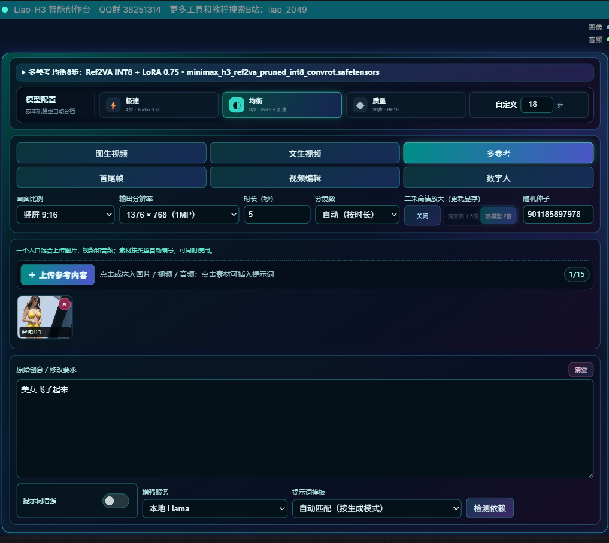

# ComfyUI-Liao2049



面向 MiniMax H3 的一体化 ComfyUI 创作节点。核心节点 **Liao-H3 智能创作台**把模型选择、LoRA、VAE、参考素材、提示词增强、生成模式、性能预设、视频编辑和二采放大集中到一个界面中。

> 本仓库不包含任何模型权重。MiniMax H3、文本编码器、VAE、LoRA、GGUF 与潜空间放大模型需由使用者按照各自许可证单独获取。

## 主要功能

### Qwen-Image 2.1 智能生图台

- 单节点整合文生图、单图编辑和最多十张参考图的多图编辑。
- 多图模式固定 `<image1>` 为基础画布，其余图片分别作为人物、服装、产品、风格或场景参考，避免身份与属性串图。
- 编辑分支沿用 ComfyUI 原生 Qwen-Image 2.1 编辑链路：动态 `images.image_N` 参考图输入、参考图 latent 作为采样画布，并启用原生 Qwen Image 2.1 缓存。
- 内置本地 Qwen-Image 2.1 T2I/I2I GGUF 提示词反推：文生图直接扩写创意，编辑模式结合视觉模型理解每张参考图。
- 默认采用 Qwen-Image 2.1 官方推荐的 Euler、simple、25 步、CFG 1 路径；支持 1K、1.5K 和原生 2K 输出。
- 顶部折叠区包含生图模型和两组可选 LoRA/强度；画面比例、清晰度、采样步数与随机种子同栏。底部 LLM 提示词推理按开关展开，默认关闭。CFG 固定为 1，负面提示词为空；底部显示模型准备和采样进度。
- 节点菜单位置：`Liao2049/Qwen Image 2.1`，节点名为 **Liao-QwenImage2.1 智能生图台**。

### Flux3 Klein 便捷多功能生图

- 构图生图：画框指定物体和文字位置，支持拖动、缩放、百分比坐标、横排/竖排文字，并随工作流保存。智能扩写默认关闭，可选本地 Flux3 prompt upsampler；扩写保留坐标与文字，位置仍属于生成引导而非像素级约束。

- 支持文生图、单图编辑与最多十张参考图的多图编辑。
- 编辑时可选择按原图比例或按设定比例输出，支持正面及负面提示词。
- 模型配置包含扩散模型、文本编码器、VAE 和两组 LoRA；参考图支持上传、拖入和剪贴板粘贴。
- 工作台随节点宽度和内容高度调整；随机种子默认变化，种子旁的按钮可固定种子。
- 节点类型：`LiaoFlux3KleinStudio`。

### MiniMax H3 六种生成模式

- 图生视频：单张首帧驱动。
- 文生视频：自动忽略参考素材并使用 FL2VA 路线。
- 多参考：图片、视频、音频可同时输入，并通过 `@图片1`、`@视频1`、`@音频1` 明确引用。
- 首尾帧：严格使用两张图片作为起始帧和结束帧。
- 视频编辑：支持通用编辑、去除字幕、动作迁移和角色替换。
- 数字人对口型：通过图片与音频时间轴分段生成，并显示当前分段进度。
- MV 模式：独立的图片轨道和音乐轨道；音乐可拖动起止手柄任意截取，截取区间就是 MV 总时间轴；每张图可独立拖动设置 2–15 秒，不再强制平均铺满。图片轨道不足音乐选区的尾段会按上一段尾帧自动分段续接（每段不超过15秒），最终逐段拼接并使用截取后的音乐。

### 模型与性能配置

- 自动识别本机 MiniMax H3 相关模型，过滤无关模型。
- 极速 4 步、均衡 8 步、二采 10 步、质量 20 步和自定义步数。
- 根据生成模式与性能档位自动匹配 FL2VA/Ref2VA 模型及可用 LoRA。
- 支持手动展开模型配置，自定义 UNet、文本编码器、双 VAE、六组 LoRA、精度、注意力后端与 SigmaShift。LoRA 与强度同行，每排两组。
- 任务开始、条件编码、模型切换和解码前进行显存释放，降低模型重叠驻留。

### 参考素材交互

- 一个入口混合上传图片、视频和音频，自动编号。
- 支持拖拽、文件选择和剪贴板粘贴图片。
- 点击素材缩略图即可把对应的 `@` 标签插入提示词。
- 多参考模式区分人物/动物、商品/物体、场景和局部属性，避免把参考图误当作整张首帧。

### 提示词增强

- 内置 MiniMax H3 官方 Skill 结构化模板。
- 内置 Liao 分镜模板，支持按时长和用户要求组织镜头。
- 本地 Llama.cpp：支持文本 GGUF 与 `mmproj` 视觉识别模型。
- 云端服务：支持 Kimi API、MiniMax API 与 OpenAI 兼容接口。
- 增强功能默认关闭；关闭时不会校验或要求 GGUF/mmproj 模型。
- 可直接采用增强结果，也可保留原始创意继续生成。

### SelfLift 二采（更耗显存）

- 数字人对口型模式禁用 SelfLift 二采；切入数字人时若原先已开启二采，自动回到均衡 8 步。

- 二采预设总计 10 步：低分辨率阶段 6 步，目标分辨率阶段 4 步。
- 最终输出尺寸仍由画面比例与分辨率选择决定；二采不会在所选输出尺寸上再额外放大。
- 放大模型可在 LoRA 下方选择；二采高清分块默认开启，仅在二采模式下生效。
- SelfLift 及所选放大模型属于二采的可选依赖；常规单采样不要求安装 SelfLift。视频保存可使用系统 FFmpeg 或 imageio-ffmpeg，无需 VideoHelperSuite。

### 兼容节点

仓库还包含从旧 WenWu 插件迁移的兼容实现：

- ACE-Step 1.5 LLM 规划与 Remix 辅助节点。
- Krea2 文生图、风格参考与洗图提示词节点。
- 旧工作流使用的节点类型 ID 尽量保持兼容，无需继续安装完整 WenWu 插件。

### Liao-Krea2 智能生图台

- 三种一键模式：文生图、洗图、风格参考。
- 完整复刻 `Krea2-文生图，风格参考-.json` 的双阶段生成链：Krea2 Raw 在 0–3 步建立结构，Krea2 Turbo 从第3步继续完成细节。
- 文生图可关闭智能改写后直接生成；洗图和风格参考会自动使用本地 Llama + mmproj 识别参考图。
- 洗图保留原图主体、数量、构图和层次，同时强制去除文字、标志、水印与界面元素。
- 风格参考只提取配色、光线、材质、镜头和氛围，不复制参考图人物与场景内容。
- 模型配置默认折叠，仅保留模式、比例、分辨率、参考图、创意描述和智能改写等常用控件。

## 安装

把整个仓库文件夹复制到：

```text
ComfyUI/custom_nodes/comfyui-liao2049
```

重启 ComfyUI，然后在节点菜单 `Liao2049/MiniMax H3` 中添加 **Liao-H3 智能创作台**。

### 依赖原则

H3 生成主体不通过 `requirements.txt` 强制安装额外 Python 包。所有特殊依赖均应由使用者在节点界面点击“检测依赖”或启动器的“一键补全依赖”后手动确认安装，避免在不同 CUDA、Python 和 PyTorch 环境中破坏现有运行栈。

本地提示词增强是可选功能：

- 需要 `llama-cpp-python>=0.3.35`，或可复用兼容的 `ComfyUI-llama-cpp_vlm` / `ComfyUI-llama-cpp` 运行环境。
- 文本 GGUF 放在 `ComfyUI/models/LLM`。
- 视觉识别所需的 `mmproj` GGUF 同样放在 `ComfyUI/models/LLM`。
- GPU offload 是否可用取决于显卡、CUDA、Python 版本和可用 wheel；通用 PyPI 包不保证带 CUDA 后端。
- OpenCV 只用于可选的视频帧视觉分析，本仓库不会自动安装。

## 模型目录

```text
ComfyUI/models/diffusion_models/       MiniMax H3 FL2VA / Ref2VA 模型
ComfyUI/models/text_encoders/          Qwen MiniMax H3 文本编码器
ComfyUI/models/vae/                    视频 VAE、音频 VAE
ComfyUI/models/loras/                  MiniMax H3 Turbo 4-step / 8-step LoRA
ComfyUI/models/LLM/                    本地提示词 GGUF 与 mmproj
ComfyUI/models/latent_upscale_models/  H3 3D 潜空间放大模型
```

潜空间二采常用模型名：

```text
h3_upscaler_lms_v0.1.safetensors
```

请按工作流选择匹配的 H3 潜空间放大模型；普通像素放大模型不能代替它。

## 使用建议

- 第一次测试建议使用 0.4MP、5 秒和均衡 8 步。
- 角色替换与动作迁移需要至少一张目标主体图片和一段源视频。
- MV 模式只接收一条主音轨；图片轨道必须完整覆盖音乐时长，单张图片为 0.5–15 秒。图片数量至少为 `音频时长 ÷ 15 秒` 向上取整，当前最多 20 张，适合约 5 分钟以内的音乐。
- 提示词中使用明确标签，例如：`让 @图片1 的人物执行 @视频1 的动作，保留 @视频1 的镜头和背景。`
- 二采在模型加载和高分辨率采样期间可能耗时较长；请结合底栏进度与日志判断。
- 高分辨率、长时长、质量 20 步与二采叠加会显著增加显存压力。

## 可移植性

- 插件不写死盘符，不随仓库分发本地模型路径。
- 提示词增强关闭时，不要求本地 Llama 模型存在。
- 缺少可选模型时提供中文错误提示，不自动联网下载。
- 不自动安装、升级或替换 PyTorch、CUDA、Triton、SageAttention 等底层环境。

## 反馈与教程

- QQ 群：`38251314`
- 更多工具和教程：B站搜索 `liao_2049`

提交问题时建议附上 ComfyUI 错误报告、运行日志、显卡型号、Python/PyTorch/CUDA 版本、所选生成模式以及模型文件名。

## 免责声明

本项目仅提供 ComfyUI 节点代码，不提供或重新分发第三方模型。使用者应遵守 MiniMax H3、相关模型、LoRA、VAE、Llama.cpp 及其他第三方组件各自的许可证和使用条款。

## YuE2 写歌与改歌工作室（2026-10-05）

分类：liao2049/音乐。节点：LiaoYuE2Studio。

不依赖外部 ComfyUI-YuE2 自定义节点。原生管线封装与 ABC 工具已经内置于 yue2_embedded；只依赖当前 ComfyUI 自带的 YuE2/SheetSage2 支持与模型文件。默认使用现有 INT8 checkpoint，旋律识别使用 models/audio_encoders/sheetsage2_bf16.safetensors。自动歌词识别使用可选 faster-whisper 与 models/whisper/faster-whisper-base；ASR 安装文件为 yue2_embedded/requirements-asr.txt。

支持 23 类风格模板、可编辑风格和歌词、原曲上传、ABC 和歌词回填、变速和移调、独立谱面规划及歌曲生成。原生管线输入仅用于可选扩展；不连接时可独立工作。第三方内置代码来源与许可证见 yue2_embedded/NOTICE 与 LICENSE。

### 可选歌词识别依赖

YuE2 的“识别歌词”需要使用运行 ComfyUI 的 Python 安装 `yue2_embedded/requirements-asr.txt`。默认本地模型目录为 `ComfyUI/models/whisper/faster-whisper-base`，需包含 `model.bin`、`config.json`、`tokenizer.json` 和 `vocabulary.txt`。节点使用 CPU/int8 识别，不会自动下载模型；Python 依赖和模型权重不随本仓库分发。


## MOSS Image 便捷多功能生图

新增 `LiaoMossImageStudio`，整合用户提供的 MOSS Base/SFT 生成、8步 LoRA、边界框构图三个工作流。工作流位于 `user/default/workflows/mossimage/liao_MOSS_Image便捷多功能生图.json`，另有构图示例。

- SFT 标准 / Base 标准：选择方案时设置50步、CFG 3.5；原始普通生成使用Euler，构图示例使用er_sde。参数可手动修改。
- SFT 极速8步：SFT + `lora_latest.safetensors`（强度1），8步、CFG 1、er_sde、simple。极速LoRA只在此方案加载；另有两个通用LoRA位置。
- SLG默认与原工作流相同：双流层留空、单流层22、开始0、结束0.5；可关闭或修改。
- 构图画布支持物体、人物、精确文字、文字方向、配色和坐标。通过内核 `MOSSImageLayoutPrompt` 转成MOSS使用的居中像素坐标，不能直接使用Flux3的构图提示格式。
- 仅输出一个“图像”接口，为最终生成结果；隐藏此工作台的来源徽标。
- 默认优先选择本地MOSS Base/SFT、Qwen3.5 9B、Flux2 VAE。量化类型跟随本地文件，原始参考工作流使用BF16，本机默认采用已有INT8模型。
- 需要支持 `moss_image` 编码器类型、`MOSSImageLayoutPrompt`、`SkipLayerGuidanceDiTSimple`、`ReferenceMultiLatent` 的ComfyUI内核。无需新增第三方节点或pip依赖。

重启ComfyUI并Ctrl+F5后加载新工作流。构图和生成方案等设置随工作流保存。


### MOSS 构图精确排字

构图模式默认使用“字体精确排字”：文字框样式不再送给扩散模型，而是改为留白区域；解码后用本地字体按原框坐标排字。只渲染文字内容字段，不绘制字体说明。支持横排、竖排和多个文字框。

“按描述自动匹配”识别楷体／楷书、宋体、黑体、微软雅黑。也可直接选择字体覆盖样式描述。Windows 使用本机已安装的对应字体；其他字体放入 ComfyUI/models/fonts 或节点的 fonts 目录，重启后选择。不打包分发系统字体。

“清除框内原字”默认开启，使用边缘采样的纯色底板覆盖文字框，避免原有字形残留；会覆盖框内原画面。要保留纹理可关闭，但模型生成的字形可能残留。字体排字是平面叠加，不自动匹配透视、遮挡和场景光照。选择“模型生成文字”可回到原版生成方式。


MOSS 示例工作流已随节点发布在 `examples/mossimage/`，可直接导入 ComfyUI。
